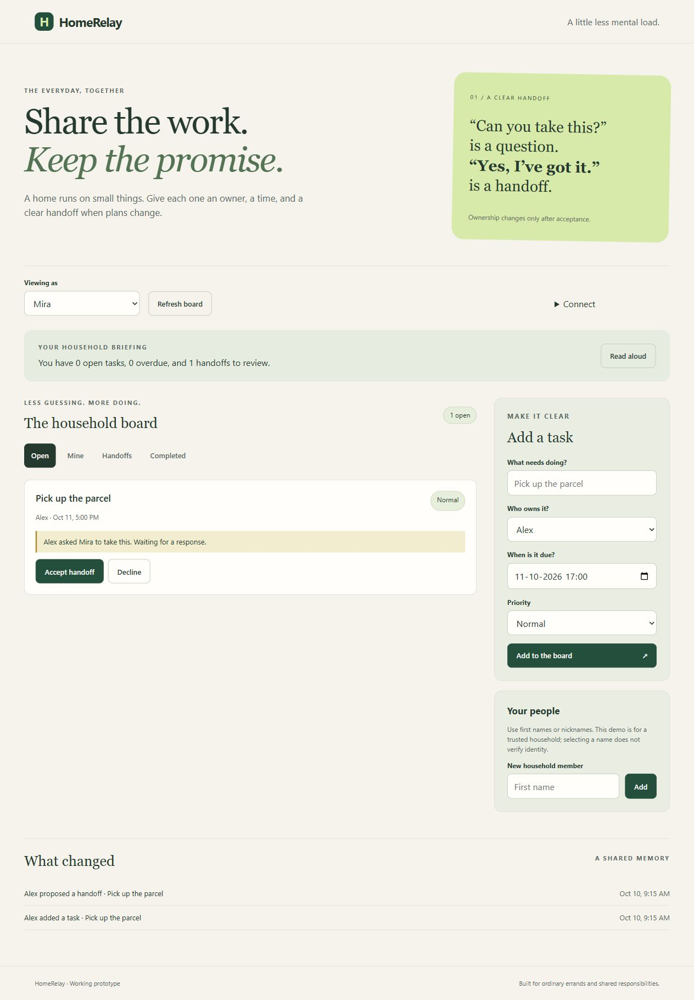

# HomeRelay

A shared household task board where asking for help does not silently transfer responsibility. The current owner stays responsible until the recipient accepts a handoff.

Built from new application source on October 10, 2026. AI assistance was used extensively for implementation, testing and documentation. No existing application repository was copied. This is a functioning prototype for a trusted household, with a browser interface and six real MCP tools.



## Run locally

Requires Python 3.11 or newer. From this directory:

```sh
python -m venv .venv
# Windows: .venv\Scripts\activate
# macOS/Linux: source .venv/bin/activate
python -m pip install -r requirements.txt
python -m uvicorn homerelay.app:app --host 127.0.0.1 --port 8741
```

Open http://127.0.0.1:8741/. Add two fictional nicknames, select the first member, create a task, propose a handoff, select the recipient, accept it, reload, and mark it complete. The Completed filter and history show the result. SQLite saves changes in `data/homerelay.db`.

The UI reads a grounded briefing aloud when browser speech synthesis is available. There is no built-in LLM, Alexa integration, notification service or external messaging.

## What works

- Create tasks with an owner, timezone-aware due date and priority.
- Propose, accept or decline a handoff; only the selected recipient can respond.
- Mark a task complete as its current owner; record an ordered history.
- Preserve state after reload and process restart.
- Reject stale changes using task versions and duplicate creation retries using request IDs.
- Obtain a briefing from stored facts through REST or MCP.

## MCP

Streamable HTTP endpoint: `http://127.0.0.1:8741/mcp/` (trailing slash matters). An MCP host can call `household_board`, `household_briefing`, `create_household_task`, `propose_handoff`, `respond_to_handoff` and `complete_household_task`.

The integration test initializes an actual HTTP MCP client using protocol version `2025-11-25`, lists the tools, creates a task, attempts a stale handoff response, then accepts and completes the task. Host instructions require human confirmation before writes. Enforcement of that confirmation remains the responsibility of the host.

## Access model

With no token, data endpoints accept only loopback clients with a localhost Host header. For network access, set a strong `HOMERELAY_TOKEN`, use HTTPS through your trusted reverse proxy, and supply `Authorization: Bearer <token>` to REST/MCP. The browser's Access settings hold the token in memory only. Set `HOMERELAY_DB` to change the database path. `.env.example` is documentation; the application does not load `.env` automatically.

One token grants access to the entire demo household. Selecting a nickname is not individual authentication. Do not use this prototype as a public multi-user service or put sensitive household information in a shared demo. It has no account isolation, rate limiting, backup service or production monitoring. Do not expose a tokenless server outside loopback.

## Validate

```sh
python -m pip install -r requirements-dev.txt
python -m pytest -q
python -m ruff check .
python -m pip check
python -m pip_audit -r requirements.txt
# Optional with Node installed:
node --check homerelay/static/app.js
```

See [validation evidence](docs/validation.md), [architecture and requirements](docs/architecture.md), and [submission draft](docs/submission.md). Tests use temporary databases; the browser screenshots contain fictional demonstration data. No publicly hosted app or final competition submission is claimed.

[Watch/download the genuine captioned browser demo](https://raw.githubusercontent.com/haresh-sai06/homerelay/main/docs/evidence/homerelay-demo.mp4) (2:42, no audio). The file records actual app states using timestamped browser captures; portal video-host compatibility remains to be checked.

## Container

```sh
docker build -t homerelay .
# Set HOMERELAY_TOKEN in your shell first; Docker forwards it without embedding it in an image.
docker run --rm -p 127.0.0.1:8741:8741 --env HOMERELAY_TOKEN -v homerelay-data:/app/data homerelay
```

Container construction is provided for portability and has not been executed in the current environment. Set a token because the container sees a forwarded network client. Hosting is optional; no paid resources were provisioned.

## Development and next steps

The initial concept was TRL 2. Integrated local tests and a browser demonstration support TRL 4. Real household evaluation, authenticated member accounts, accessible usability testing and a verified operational deployment are needed before claiming TRL 5 or higher.

The current source and assets were produced with Codex assistance under the team lead's authorization. Teammate contributions have not been established and must be confirmed before a competition entry represents them. MIT license applies to original application source; dependencies retain their own licenses.
