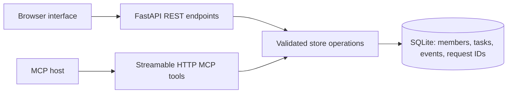

# Requirements and architecture

Problem: household requests can leave both people assuming the other person owns an errand. HomeRelay makes the request and acceptance separate states.

Target workflow: a trusted household member creates a task, asks another member to take it, and the recipient accepts or declines. The owner can finish it. Everyone can inspect the same history.

Every write validates member IDs, current task version and allowed state transitions. A SQLite immediate transaction serializes changes. Task creation records a request fingerprint so a retried identical request returns the existing task; a reused ID with different details is rejected.

Task states: open with an owner; open with a proposed recipient; accepted with a new owner or declined with the original owner; done. Proposal alone never transfers ownership. Selecting an actor is a trusted-demo convention, not authenticated authorization.

| Acceptance criterion | Evidence |
|---|---|
| Owner stays responsible until recipient accepts | Store, REST, MCP and browser journeys |
| Recipient alone can respond to a pending request | Store conflict test |
| Stale or concurrent edits cannot both succeed | Version and concurrent-write tests |
| Retries do not duplicate task creation | Fingerprint test and REST journey |
| State survives restart | Reopened SQLite store test and browser reload |
| Due dates include a timezone | Validation test |
| Browser can complete the core workflow | Three captured screenshots |
| MCP performs real mutations over HTTP | Subprocess client integration test |
| Data access rejects missing tokens and cross-origin requests | Middleware tests |

MVP exclusions: individual accounts, multi-household tenancy, payments, real-time push notifications, Alexa host connection, production deployment, and user adoption metrics. No performance claim or field study has been made.
