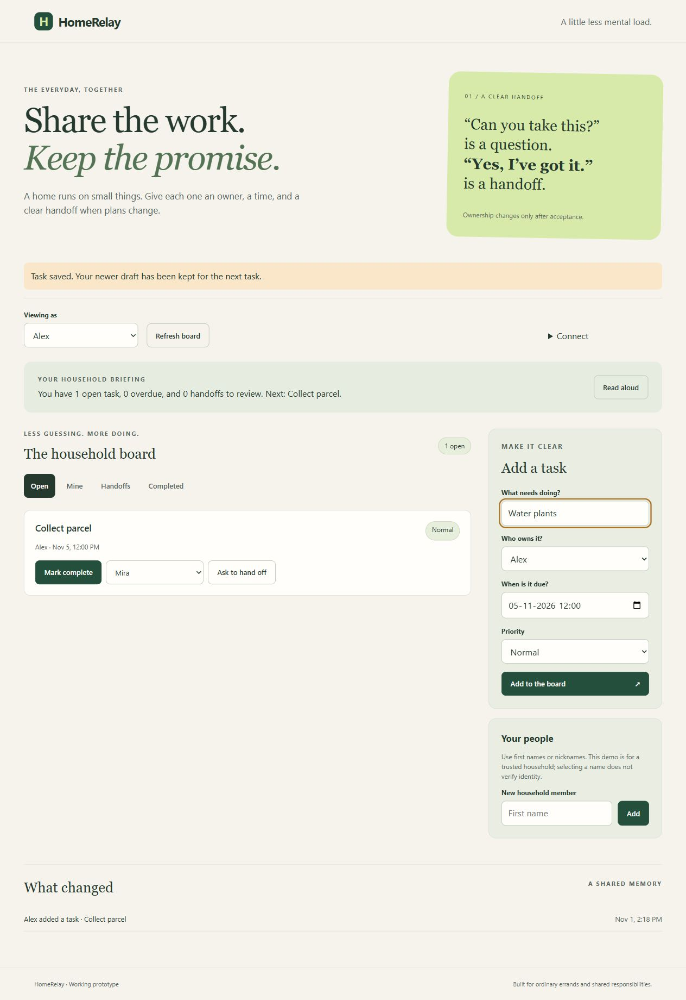
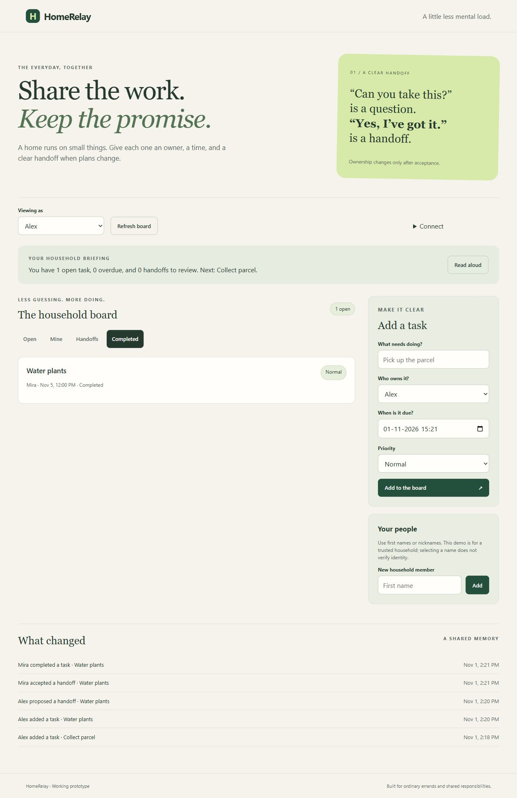

# Browser retry validation — 1 November 2026

Application tested: `ff410ed4c88b49270f36e754e2de79c0003373db`.

The supported in-app browser recovered at the scheduled afternoon retry. Six manual scenarios passed against the actual frontend, FastAPI backend and a new isolated SQLite database on loopback. No ordinary household database was used. The fixture replaced one successful creation acknowledgement with HTTP 503 **after the real store committed**, then delayed later creation responses by eight seconds to allow editing while saving. Application source was unchanged.

| Scenario | Observed result |
|---|---|
| Failed acknowledgement | The server committed the synthetic parcel task, but the fixture returned 503. The browser displayed the error, retained the complete draft and enabled submission again. |
| Unchanged retry | The next request carried exactly the same payload and request ID. Two HTTP submissions produced one task, one request key and one creation event. |
| Edit while saving | While the retry acknowledgement was delayed, the title was changed to `Water plants`. The earlier parcel task appeared once; the newer text remained with an explicit next-task notice. |
| Intentional new task | Submitting that new draft used a different request ID. There were two stored tasks after three HTTP submissions; the unchanged form cleared after acknowledgement. |
| Handoff and completion | Alex proposed the plant task to Mira. Ownership stayed with Alex until Mira accepted. Mira then completed the task through the normal confirmation dialog. |
| Reload and persistence | After browser reload, the parcel remained open and the Completed filter showed the plant task owned by Mira. SQLite and the ordered history agreed. |

Final database assertions: two task rows, two request keys and five events in this order: `created`, `created`, `propose`, `accept`, `complete`. The first two task payloads and request IDs matched; the third key differed. These are synthetic laboratory cases, not real errands, users or household adoption.

An initial lab wrapper expected HTTP 200 and therefore failed to inject an error into the API's HTTP 201 response. That warm-up was stopped and preserved separately. The completed run used a new database and corrected the fixture to accept any successful 2xx response before injecting the failure. This was a fixture correction, not an application fix.

The owned lab server was stopped and the temporary browser tab closed after validation. No deployment, additional submission, new demo video or higher TRL is claimed. Retry keys still do not survive reloads, changed details or a new intentional task; inspect the board after an uncertain save. Individual authentication and an operational household trial remain outside scope. TRL 4 is retained.

